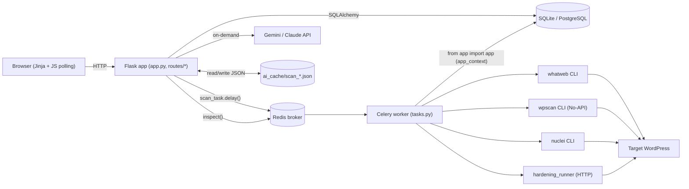
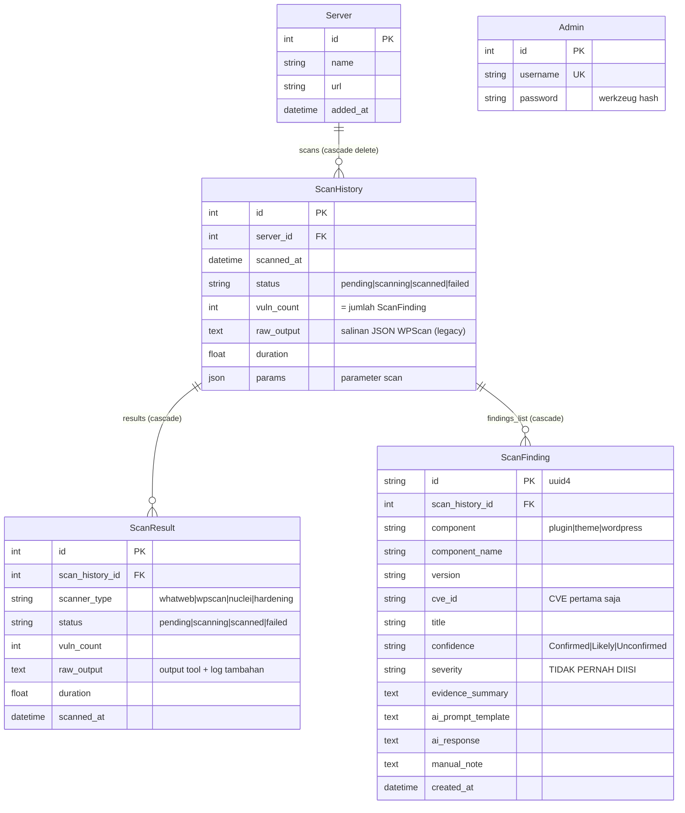
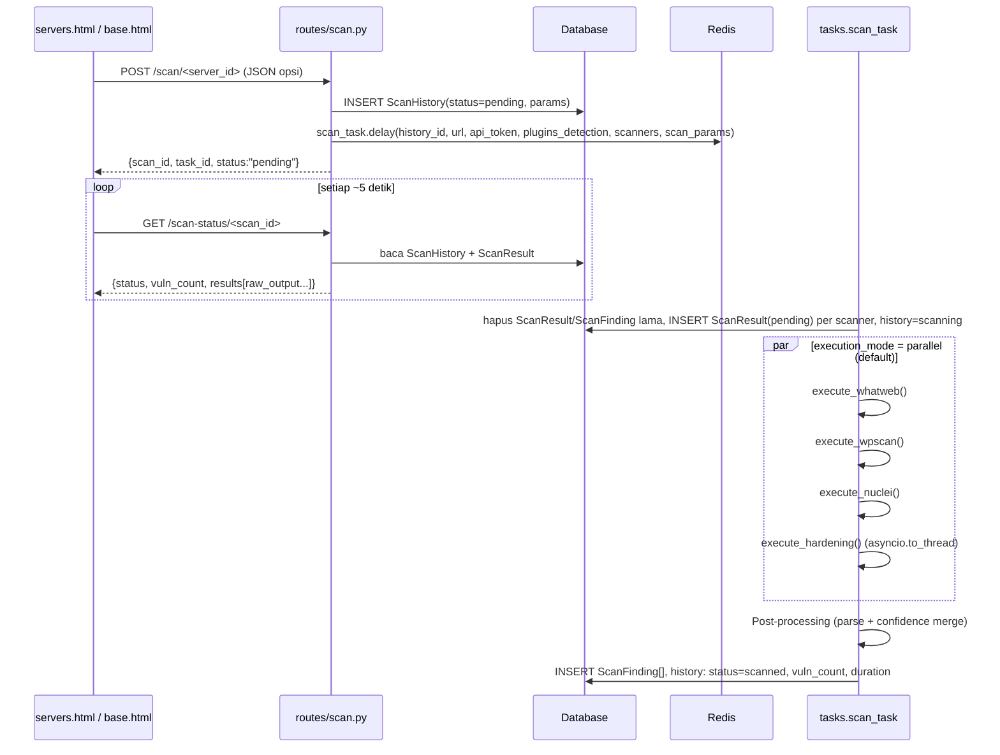

# WP-SecOps — Arsitektur Sistem

> **Tujuan dokumen:** satu-satunya referensi yang perlu dibaca sebelum mengubah kode.
> Semua alur, kontrak data, endpoint, dan dependensi antar-file dirangkum di sini.
> **Aturan:** setiap PR/perubahan yang menyentuh struktur (route, model, field JSON, scanner, env var)
> **wajib** memperbarui bagian terkait di dokumen ini (lihat §14 *Checklist Pemeliharaan*).

Terakhir disinkronkan dengan kode: **2026-11-17 (pasca-eksekusi Fase 0–4 `next-plan.md`)**

---

## 1. Ringkasan

WP-SecOps adalah aplikasi web **Flask** (server-rendered, UI Bahasa Indonesia) untuk memindai banyak situs WordPress secara terpusat. Satu scan menjalankan **pipeline 4 fase** di **Celery worker**:

| Fase | Scanner | Jenis | Implementasi |
|---|---|---|---|
| 1 | **WhatWeb** | Identifikasi teknologi (CMS, server, PHP, JS) | CLI subprocess (async) |
| 2 | **WPScan** | Fingerprint WP + enumerasi plugin/tema/user (**No-API mode**) | CLI subprocess (async) |
| 3 | **Nuclei** | Deteksi eksposur aktif (`-tags wordpress`) | CLI subprocess (async) |
| 4 | **Hardening** | Audit hardening eksternal via HTTP (13 cek) | Python murni (`requests`), di thread |

Hasilnya digabung (*post-processing*) menjadi **ScanFinding** dengan tingkat **confidence**. Rekomendasi AI (Gemini / Claude) **on-demand per temuan** dari halaman detail.

---

## 2. Tech Stack

| Lapisan | Teknologi |
|---|---|
| Web | Flask 3 (`Flask[async]`), Jinja2, Flask-Login, Werkzeug |
| ORM/DB | Flask-SQLAlchemy 3.1 → default **SQLite** `wpsecops.db` (bisa PostgreSQL via `DATABASE_URL`) |
| Async job | Celery 5.4 + Redis (broker & result backend), eventlet |
| Frontend | Tailwind CSS (Play CDN), Chart.js (CDN), vanilla JS `fetch` + polling. **Tidak ada build step.** |
| AI | Google Gemini REST API, Anthropic Messages API (via `requests`), `json_repair` |
| Tools eksternal | `whatweb`, `wpscan` (Ruby gem), `nuclei` + nuclei-templates |
| Lab target | `docker-compose.yml`: 10 WordPress (4.6 → latest) + MySQL 5.7, port 8081–8090 |

---

## 3. Peta Direktori

```
wpsecops/
├── app.py                 # Factory create_app(), init_db(), _migrate_schema(), /healthz, flask init-db
├── config.py              # class Config (env var, session hardening, CSRF, rate limit, MySQL/SQLite)
├── extensions.py          # db, login_manager, csrf, limiter, migrate, celery_init_app, SQLite WAL pragma
├── tasks.py               # scan_task, ai_analyze_finding_task, LiveLogWriter (Redis+DB), recover_orphan_scans
├── models/
│   ├── __init__.py        # re-export: db, Admin, Server, ScanHistory, ScanResult, ScanFinding
│   ├── admin.py           # Admin (UserMixin)
│   ├── server.py          # Server
│   └── scan.py            # ScanHistory, ScanResult, ScanFinding (dengan index & field AI/severity)
├── routes/
│   ├── __init__.py        # register_routes(app): daftarkan 5 blueprint
│   ├── auth.py            # auth_bp   : login (rate-limited), change-password, logout
│   ├── main.py            # main_bp   : dashboard, statistics (SQL), system-status (real ping), async-worker
│   ├── servers.py         # servers_bp: CRUD server + validasi URL + subquery N+1-free
│   ├── scan.py            # scan_bp   : trigger scan (409 guard) + polling ringan (/scan-status)
│   ├── history.py         # history_bp: list (paginated), detail laporan, workflow timeline, AI async, note, hapus
│   └── riset.py           # riset_bp  : halaman /riset (5 tabel komparatif penelitian, tidak di nav)
├── services/
│   ├── __init__.py        # re-export registry, parsers, correlation, runners, AI
│   ├── registry.py        # ScannerSpec & SCANNERS registry (single source of truth 4 fase)
│   ├── parsers.py         # Parser tunggal WhatWeb, WPScan, Nuclei, Hardening
│   ├── correlation.py     # assign_confidence() (token-boundary + version check)
│   ├── prompts.py         # Builder prompt dinamis (remediasi & CVE search)
│   ├── whatweb_runner.py  # run_whatweb()   (async)
│   ├── wpscan_runner.py   # run_wpscan()    (async, No-API)
│   ├── nuclei_runner.py   # run_nuclei()    (async)
│   ├── hardening_runner.py# run_hardening() (sync, ThreadPoolExecutor + cache homepage)
│   └── vuln_analyzer.py   # LLMClient terpadu (header x-goog-api-key, retry, error sanitization)
├── tests/                 # Suite pytest (parsers, correlation, vuln_analyzer, routes E2E)
├── templates/             # Jinja2 (semua extends base.html) — lihat §8
├── static/style.css, static/images/logo_wpsecops.png
├── ai_cache/              # (runtime, gitignored) scan_<id>.json — cache AI legacy, dibaca statistics & servers
├── start.sh               # Jalankan redis + celery worker (bg, celery.log) + python app.py (dev, WSL)
├── check_services.sh      # Cek dependensi OS/venv/.env
├── env.example            # Template .env
├── docker-compose.yml, uploads.ini   # Lab target WordPress rentan (bukan bagian aplikasi)
├── DEPLOYMENT_UBUNTU.md, installation.md, scanner.md   # Panduan operasional
├── PRODUCT.md, DESIGN.md  # Konteks produk & design system UI
└── README.md / README_ID.md  # (isi saat ini = README Nuclei, bukan dokumentasi app)
```

---

## 4. Topologi Runtime



**Proses yang harus berjalan:** Redis, Celery worker (`celery -A tasks.celery_app worker`), Flask (`python app.py` dev :5000 / gunicorn prod).

**Catatan penting:**
- `app.py` mengeksekusi `app = create_app()` saat di-import ⇒ `init_db()` jalan setiap import (termasuk di worker saat `scan_task` melakukan `from app import app`).
- Worker dan Flask **berbagi DB yang sama**; komunikasi progres scan **hanya lewat DB** (bukan Redis result).
- Env var dibaca saat import (`load_dotenv()` di `config.py`, `tasks.py`, `services/*`). Ubah `.env` ⇒ **restart Flask dan worker**.

---

## 5. Model Data



**Properti turunan:**
- `ScanHistory.interesting_count` → `len(raw_output JSON["interesting_findings"])`.
- `Server.last_status`, `Server.total_vulns` → dari ScanHistory terbaru (query per akses, N+1).

**`ScanHistory.params` (JSON):** `{plugins_detection, scanners[], cookies, headers[], nuclei_severity, nuclei_tags, nuclei_headless}`.

**Migrasi skema:** tidak ada Alembic. `db.create_all()` + `_migrate_schema()` di `app.py` (manual `ALTER TABLE`, saat ini hanya menambah `scan_history.params`). **Kolom baru di tabel lama ⇒ tambahkan ke `_migrate_schema()`.**

**Seed:** jika tabel `admin` kosong → buat `admin` / `admin123`.

---

## 6. Alur Utama: Scan Pipeline

### 6.1 Sequence



### 6.2 Detail `scan_task` (`tasks.py`)

1. Normalisasi `scanners` ke subset urut dari `ALL_SCANNERS = ["whatweb","wpscan","nuclei","hardening"]` (kosong ⇒ semua).
2. `execution_mode = scan_params.get("execution_mode", "parallel")` → `"sequential"` atau `asyncio.gather` paralel.
   ⚠️ Route **tidak pernah** mengirim `execution_mode` ⇒ selalu **parallel**.
3. Tiap `execute_<scanner>()`:
   - set `ScanResult.status = scanning`
   - jalankan runner dengan `log_callback` → `ThrottledLogWriter` (append ke `ScanResult.raw_output`, flush tiap 0.6 dtk / 3 baris) ⇒ log live untuk polling UI.
   - setelah selesai: **timpa** `raw_output` dengan output asli tool, set `status`, `duration`, `vuln_count`; lalu append baris `[X] Selesai ...`.
   - ⇒ `ScanResult.raw_output` final = **output tool + beberapa baris log di akhir**. Konsumen harus mengekstrak JSON (dari `{` pertama s/d `}` terakhir).
4. `vuln_count` per scanner: whatweb=0, wpscan=0, nuclei=jumlah finding JSONL, hardening=jumlah `FAIL`.
5. Exception apa pun di pipeline ⇒ `ScanHistory.status = failed`.

### 6.3 Post-processing & Confidence

| Langkah | Fungsi (`tasks.py`) | Output |
|---|---|---|
| Parse WPScan JSON | `parse_wpscan_components(raw)` | `components[]` (theme + plugin: name, version, outdated, latest_version) + `target_info` |
| Parse Nuclei JSONL | `parse_nuclei_findings(raw)` | `[{template_id, name, severity, description, remediation, tags, cve_ids, matched_at}]` |
| Cross-match | `assign_confidence(nf, components)` | `component_name` ⊂ `template_id`/`name` ⇒ **Confirmed**, selain itu **Likely** |

Pembuatan `ScanFinding`:
- **Setiap finding Nuclei** → 1 ScanFinding (`Confirmed`/`Likely`), `evidence_summary` + `ai_prompt_template` (prompt remediasi, Bahasa Indonesia).
- **Setiap komponen WPScan** yang **tidak** tercakup finding Nuclei → ScanFinding `Unconfirmed` (prompt: "apakah versi ini punya kerentanan?").
- WhatWeb hanya menyumbang konteks tech stack ke evidence/prompt. Hardening **tidak** menghasilkan ScanFinding (ditampilkan terpisah).
- `ScanHistory.raw_output` = salinan JSON WPScan (dipakai `servers.py` & fallback legacy).

---

## 7. HTTP Endpoints

Semua kecuali login memakai `@login_required`.

| Blueprint | Method | Path | Fungsi | Output |
|---|---|---|---|---|
| auth | GET/POST | `/` | `login` | `login.html` → redirect dashboard |
| auth | GET | `/logout` | `logout` | redirect `/` |
| main | GET | `/dashboard` | `dashboard` | `dashboard.html` (KPI, 5 scan terbaru, celery_stats) |
| main | GET | `/system-status` | `system_status` | `system_status.html` (`check_system_dependencies()`) |
| main | GET | `/async-worker` | `async_worker` | `async_worker.html` |
| main | GET | `/api/celery-stats` | `api_celery_stats` | JSON `get_celery_task_stats()` |
| main | GET | `/statistics` | `statistics` | `statistics.html` (DB + **ai_cache**) |
| servers | GET/POST | `/servers` | `servers` | list (paginate 9) / tambah server (form `name`,`url`) |
| servers | POST | `/servers/delete/<id>` | `delete_server` | redirect (cascade hapus scan) |
| servers | POST | `/servers/edit/<id>` | `edit_server` | redirect |
| scan | POST | `/scan/<server_id>` | `scan_server` | JSON `{scan_id, task_id, status, plugins_detection}` |
| scan | POST | `/scan/bulk` | `bulk_scan` | JSON `{message, items[{server_id, scan_id, task_id}]}` |
| scan | GET | `/scan-status/<scan_id>` | `get_scan_status` | JSON `{status, vuln_count, duration, results[]}` |
| history | GET | `/history?server_id=` | `history` | `history.html` |
| history | GET | `/history/<id>` | `history_detail` | `history_ai.html` (laporan utama) |
| history | GET | `/history/<id>/workflow` | `workflow_timeline` | `workflow.html` |
| history | GET | `/history/<id>/pipeline` | `pipeline_timeline` | redirect → workflow |
| history | POST | `/history/finding/<uuid>/analyze` | `analyze_finding` | JSON `{success, ai_response}` → simpan ke `ScanFinding.ai_response` |
| history | POST | `/history/finding/<uuid>/note` | `save_finding_note` | JSON → `ScanFinding.manual_note` |
| history | POST | `/history/<id>/generate/<idx>` | `generate_single_recommendation` | JSON; tulis `ai_cache/scan_<id>.json` (**legacy**) |
| history | POST | `/history/<id>/delete` | `delete_history` | hapus DB + file ai_cache |

**Body JSON `POST /scan/<id>` & `/scan/bulk`:**
```json
{
  "server_ids": [1,2],                // bulk saja
  "plugins_detection": "passive",     // passive|mixed|aggressive (invalid → passive)
  "scanners": ["whatweb","wpscan","nuclei","hardening"],
  "cookies": "k=v; k2=v2",            // → wpscan --cookie, nuclei -cookies
  "headers": ["X-H: v"],              // → wpscan --headers, nuclei -H
  "nuclei_severity": "critical,high", // default critical,high,medium,low
  "nuclei_tags": "cve,xss",           // ditambah ke tag 'wordpress'
  "nuclei_headless": false
}
```
Catatan: `api_token` (dari `WPSCAN_API_TOKEN`) dikirim ke task tapi **diabaikan** (task memanggil `run_wpscan(api_token=None)`).

---

## 8. Frontend (templates/)

Semua template ``. Tailwind & Chart.js dari CDN. Tidak ada bundler.

| Template | Dirender oleh | Data context | JS / endpoint yang dipanggil |
|---|---|---|---|
| `base.html` | semua | — | Sidebar nav; helper polling `/scan-status/<id>` (5 dtk) & `POST /scan/<id>` |
| `login.html` | `auth.login` | — | form POST |
| `dashboard.html` | `main.dashboard` | `stats, recent_scans, celery_stats` | — |
| `servers.html` | `servers.servers` | `servers[]` (id,name,url,added_at,last_status,total_vulns,color,last_scan_id), `pagination` | `POST /scan/<id>`, `POST /scan/bulk`, polling `/scan-status/<id>`; modal opsi scan |
| `history.html` | `history.history` | `histories, servers, selected` | form delete |
| `history_ai.html` | `history.history_detail` | `h, ai_analysis{findings[], overall_*}, findings_count, target_info, api_error, interesting_findings, hardening` | `POST /history/finding/<id>/analyze`, `/note`, `POST /history/<id>/generate/<idx>`; Chart.js |
| `history_detail.html` | *(tidak dirender oleh route mana pun — legacy)* | — | — |
| `workflow.html` | `history.workflow_timeline` | `h, timeline[]` (lihat `build_pipeline_timeline`) | — |
| `statistics.html` | `main.statistics` | `stats, trend_labels, trend_values, ai_stats, matrix, server_stats` | Chart.js |
| `system_status.html` | `main.system_status` | `dependencies[]` | — |
| `async_worker.html` | `main.async_worker` | `celery_stats` | polling `/api/celery-stats`, Chart.js |

**Warna kartu server** (`servers.py`): biru = belum scan / pending / scanning / failed; hijau = `vuln_count == 0`; merah = `vuln_count >= 5` **atau** high/critical (dari `ai_cache.overall_severity` atau CVSS ≥ 7 di JSON WPScan); kuning = sisanya.

**Severity di laporan** (`history.py::_severity_from_confidence`): Confirmed → high, Likely → medium, lainnya → low. Overall severity = tertinggi.

Design system (warna, font, komponen): lihat `DESIGN.md` & `PRODUCT.md`.

---

## 9. Kontrak Services

### 9.1 Runner scanner (dipanggil hanya dari `tasks.py`)

| Fungsi | Signature | Perintah / mekanisme | Timeout | Return dict |
|---|---|---|---|---|
| `run_whatweb` | `async (target_url, log_callback=None)` | `whatweb --log-json=- -a 3 --no-errors URL` | 120 s | `{status, duration, raw_output, tech_stack{name:ver}, target_info{wordpress_version, server, php_version, ip_address, technologies[]}}` — parser toleran (JSON / JSONL / teks berwarna) |
| `run_wpscan` | `async (target_url, api_token=None, plugins_detection="passive", log_callback=None, cookies=None, headers=None)` | `wpscan --url URL --format json --enumerate vp,vt,u,tt,cb --plugins-detection X --max-threads 10 --disable-tls-checks --no-update` (env `WPSCAN_API_TOKEN` **dihapus** dari child env) | 600 s | `{status, duration, raw_output, stderr, vuln_count, interesting_count, detail, target_info, plugin_details, users_detected, interesting_findings}` |
| `run_nuclei` | `async (target_url, log_callback=None, cookies=None, headers=None, severity=None, extra_tags=None, headless=False, templates_path=None)` | `nuclei -u URL -tags wordpress[,extra] -severity S [-headless] [-cookies] [-H] -jsonl -v` | 900 s | `{status, duration, raw_output (JSONL), stderr, vuln_count, findings[]}` |
| `run_hardening` | `sync (base_url, timeout=10)` | `WPHardeningChecker.run_all()` — GET pasif | 10 s/request | `{target, generated_at, summary{PASS,FAIL,WARN,INFO,SKIP: n}, checks[{id,title,status,detail,recommendation,reference}], disclaimer}` |

`status` runner: `"scanned"` atau `"failed"`. Tool tidak terinstall ⇒ `failed` + pesan di `raw_output` (tidak raise).

**Daftar cek hardening** (`check_id`): `https_scheme`, `https_login`, `hsts`, `tls_cert`, `sec_headers`, `wp_admin_access`, `wp_includes_php`, `wp_config_exposure`, `dir_listing`, `version_disclosure`, `user_enum`, `xmlrpc`, `file_editor`, `brute_force_protection`, `backup_exposure`.
Tambah cek baru = buat method `check_*` di `WPHardeningChecker` lalu daftarkan di `run_all()`.

### 9.2 AI (`services/vuln_analyzer.py`)

| Fungsi | Dipakai oleh | Perilaku |
|---|---|---|
| `call_llm_text(prompt, provider)` | `analyze_finding` | Return **string** teks; error dikembalikan sebagai string berawalan `"Error:"`. Retry 3× (429 backoff 5/10 dtk, 5xx, timeout). |
| `build_cve_search_prompt(finding)` | `analyze_finding` | Prompt "hanya nomor CVE, nama, link NVD" (untuk temuan non-Confirmed) |
| `analyze_single_vulnerability(vuln, url, provider)` | `generate_single_recommendation` (legacy) | Return dict JSON `{severity, severity_reason, recommendations[]}` atau `{error}` |
| `analyze_vulnerabilities(raw, url)` | **tidak dipakai** (sisa mode WPScan-API) | Analisis massal; provider dari `VULN_ANALYZER_PROVIDER` |
| `_call_gemini` / `_call_anthropic` / `_parse_json_safely` | internal | Gemini: `responseMimeType=application/json`, auto-continue saat `MAX_TOKENS` (≤4×), `json_repair` fallback |

**Alur tombol AI di `history_ai.html` (`POST /history/finding/<id>/analyze`, body `{provider: "gemini"|"claude"|"anthropic"}`):**
- `confidence == "Confirmed"` ⇒ prompt = `ScanFinding.ai_prompt_template` (rekomendasi remediasi).
- lainnya ⇒ prompt = `build_cve_search_prompt(...)` (pencarian CVE).
- Respons disimpan ke `ScanFinding.ai_response`.

Endpoint API: Gemini `https://generativelanguage.googleapis.com/v1beta/models/{GEMINI_MODEL}:generateContent`, Anthropic `https://api.anthropic.com/v1/messages` (`anthropic-version: 2023-06-01`).

---

## 10. Penyimpanan Selain DB

**`ai_cache/scan_<history_id>.json`** (dibuat `generate_single_recommendation`, dihapus `delete_history`):
```json
{
  "findings": { "<idx>": {"index", "component", "component_name", "title", "cve_ids", "severity", "severity_reason", "recommendations", "provider"} },
  "overall_severity": "high",
  "overall_summary": "..."
}
```
Dibaca oleh: `main.statistics` (distribusi severity/komponen/provider) dan `servers.servers` (warna kartu).
⚠️ Alur AI utama sekarang menyimpan ke `ScanFinding.ai_response`, **bukan** ai_cache ⇒ statistik AI hanya mencerminkan data legacy.

---

## 11. Konfigurasi (env)

| Variabel | Default | Dipakai di |
|---|---|---|
| `FLASK_SECRET_KEY` | `wp-secops-secret-2026` | `config.py` |
| `DATABASE_URL` | `sqlite:///<repo>/wpsecops.db` | `config.py` |
| `CELERY_BROKER_URL` / `CELERY_RESULT_BACKEND` | `redis://localhost:6379/0` | `tasks.py`, `config.py` |
| `CELERY_TASK_ALWAYS_EAGER` | `False` | `tasks.py` (True = jalan sinkron tanpa worker, berguna untuk debug) |
| `GEMINI_API_KEY` (`GOOGLE_API_KEY` dicek di system-status) | — | `vuln_analyzer.py`, `main.py` |
| `GEMINI_MODEL` / `GEMINI_TIMEOUT` | `gemini-3.5-flash` / `180` | `vuln_analyzer.py` |
| `ANTHROPIC_API_KEY` | — | `vuln_analyzer.py`, `main.py` |
| `ANTHROPIC_MODEL` / `ANTHROPIC_TIMEOUT` | `claude-sonnet-5` / `60` | `vuln_analyzer.py` |
| `VULN_ANALYZER_PROVIDER` | `gemini` (config) / `anthropic` (vuln_analyzer) | hanya `analyze_vulnerabilities` (tidak dipakai) |
| `WPSCAN_API_TOKEN` | — | dibaca `scan.py` lalu diabaikan; dihapus dari env wpscan |
| `NUCLEI_TEMPLATES_DIR` | — | `main.py` (cek status saja; kandidat lain `~/nuclei-templates`, `/home/idris/nuclei-templates`) |

`Config` di `config.py` hanya dipakai Flask; `tasks.py` & `services/*` membaca `os.getenv` langsung.

---

## 12. Panduan Dampak Perubahan ("mau ubah X → sentuh file Y")

| Perubahan | File yang harus disentuh |
|---|---|
| **Tambah scanner baru** | `services/<x>_runner.py` (+ export di `services/__init__.py`) → `tasks.py` (`ALL_SCANNERS`, writer, `execute_<x>()`, daftar mode sequential & parallel, post-processing bila menghasilkan finding) → `routes/scan.py` (default `scanners`) → `routes/history.py` (`PHASE_ORDER`, `PHASE_META`, `LOG_PREFIXES`, parser di `get_scan_findings_and_info` bila perlu) → `routes/main.py::check_system_dependencies` → `servers.html` (payload bulk) → `history_ai.html`/`workflow.html` |
| Ubah argumen CLI scanner | runner terkait saja (pastikan format output tetap JSON yang diparse di `tasks.py` & `history.py`) |
| Tambah opsi scan dari UI | `servers.html` (modal + body fetch) → `routes/scan.py` (`scan_params` **dan** `params`, di kedua endpoint single & bulk) → `tasks.py` (teruskan ke runner) → runner |
| Aktifkan mode sequential | kirim `execution_mode` dari UI → tambahkan ke `scan_params` di `routes/scan.py` |
| Ubah logika confidence / pembentukan finding | `tasks.py` (`assign_confidence`, blok post-processing) + `history.py::_severity_from_confidence` + filter di `history_ai.html` |
| Tambah kolom DB | `models/*.py` + `app.py::_migrate_schema()` (untuk DB lama) + serializer di route terkait |
| Tambah halaman | route di blueprint + template `extends base.html` + link di sidebar `base.html` |
| Tambah provider AI | `vuln_analyzer.py` (`call_llm_text`, `analyze_single_vulnerability`) + validasi provider di `history.py` (2 tempat) + `main.py` (status) + `config.py`/`env.example` + dropdown di `history_ai.html` |
| Ubah prompt AI remediasi | `tasks.py` (`prompt_template`, disimpan per finding saat scan — finding lama tidak berubah) |
| Ubah prompt pencarian CVE | `vuln_analyzer.py::build_cve_search_prompt` |
| Ubah aturan warna kartu server | `routes/servers.py::servers` |
| Ubah statistik | `routes/main.py::statistics` + `statistics.html` |
| Ubah auth / user | `routes/auth.py`, `models/admin.py`, seed di `app.py::init_db` |
| Ubah tampilan/tema | `DESIGN.md` (sumber kebenaran) + `base.html` + `static/style.css` |

---

## 13. Known Issues & Technical Debt (Tersisa)

1. Statistik AI & `ai_cache/` legacy: route legacy `generate_single_recommendation` sudah dihapus, namun folder `ai_cache/` lama bila ada belum dimigrasikan otomatis.
2. Frontend masih memakai Tailwind Play CDN dan JS inline di `history_ai.html` / `servers.html` (belum di-bundle lokal).
3. `README.md` / `README_ID.md` masih berisi README Nuclei, bukan dokumentasi WP-SecOps.
4. Belum ada Celery Beat / fitur opsional Fase 5 (scan terjadwal, diff antar scan, export PDF/CSV).

---

## 14. Checklist Pemeliharaan Dokumen

Saat mengubah kode, perbarui bagian berikut:

- [ ] Route baru/berubah → §7 (tabel endpoint) & §8 (template/JS)
- [ ] Model/kolom baru → §5 (ERD) & catat migrasi
- [ ] Scanner/argumen CLI/format output → §1, §6, §9.1
- [ ] Prompt/provider AI → §9.2, §11
- [ ] Env var baru → §11 + `env.example`
- [ ] File/folder baru → §3
- [ ] Bug di §13 diperbaiki → hapus dari daftar
- [ ] Update tanggal "Terakhir disinkronkan" di atas
