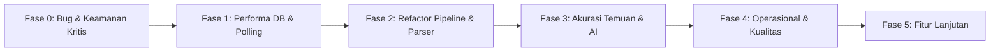

# WP-SecOps — Next Plan (Rencana Optimasi)

> Disusun dari analisis kode (lihat `ARCHITECTURE.md`). Tanggal: **2026-11-17**.
> Tiap item: **Masalah → Solusi → File → Effort (S ≤ ½ hari, M ≤ 2 hari, L > 2 hari) → Dampak**.
> Kerjakan berurutan per fase; fase lebih awal = risiko lebih tinggi / effort lebih kecil.

---

## Ringkasan Prioritas



| Fase | Fokus | Total effort | Dampak utama |
|---|---|---|---|
| 0 | Bug & keamanan | ~1 hari | Mencegah crash & akses tidak sah |
| 1 | DB, polling, query | ~3 hari | Hilangkan `database is locked`, beban server turun drastis |
| 2 | Refactor pipeline/parser | ~4 hari | Kode lebih kecil, mudah tambah scanner |
| 3 | Akurasi temuan & AI | ~3 hari | Laporan lebih tepat, request web tidak blocking |
| 4 | Ops & kualitas | ~3 hari | Siap produksi, ada test & migrasi |
| 5 | Fitur lanjutan | opsional | Scan terjadwal, notifikasi, export |

---

## Fase 0 — Bug & Keamanan Kritis (kerjakan dulu)

### 0.1 Fix `NameError` di Nuclei runner — **S**, dampak tinggi
- **Masalah:** `services/nuclei_runner.py` → `if not raw_output and process.returncode == 0` (`process` tidak ada) ⇒ fase Nuclei crash bila exit 0 tanpa output, dan seluruh scan jadi `failed`.
- **Solusi:** ganti `process.returncode` → `returncode`.

### 0.2 Fix CLI hardening — **S**
- `services/hardening_runner.py`: tambah `import sys`; definisikan `output_str` juga di mode `text`.

### 0.3 Matikan debug & amankan kredensial — **S**, dampak tinggi
- **Masalah:** `app.run(debug=True)` (Werkzeug debugger = RCE bila terekspos), default `admin/admin123`, default `SECRET_KEY`.
- **Solusi:**
  - `debug=os.getenv("FLASK_DEBUG") == "1"`.
  - Seed admin dari env `ADMIN_USERNAME` / `ADMIN_PASSWORD`; bila kosong → generate password acak & cetak sekali ke log.
  - Tolak start di production bila `FLASK_SECRET_KEY` masih default.
  - Tambah halaman **ganti password**.
- **File:** `app.py`, `config.py`, `routes/auth.py`, `env.example`.

### 0.4 CSRF & hardening sesi — **M**, dampak tinggi
- **Masalah:** semua POST (hapus server/history, trigger scan, AI) tanpa CSRF token.
- **Solusi:** `Flask-WTF` `CSRFProtect`; `{{ csrf_token() }}` di form; header `X-CSRFToken` di semua `fetch` (helper di `base.html`). Set `SESSION_COOKIE_HTTPONLY`, `SESSION_COOKIE_SAMESITE="Lax"`, `SESSION_COOKIE_SECURE` (prod), `PERMANENT_SESSION_LIFETIME`.
- **File:** `extensions.py`, `config.py`, semua template dengan form/fetch.

### 0.5 Rate-limit login — **S**
- `Flask-Limiter` di `POST /` (mis. 5/menit/IP).

### 0.6 API key Gemini jangan di query string — **S**
- **Masalah:** `?key=...` di URL bisa bocor ke log/proxy/pesan error (`resp.text`, exception yang ditampilkan ke UI).
- **Solusi:** pakai header `x-goog-api-key`. Sanitasi pesan error sebelum dikirim ke UI.
- **File:** `services/vuln_analyzer.py`.

### 0.7 Validasi URL target — **S**
- Validasi skema `http/https` + hostname saat tambah/edit server (`routes/servers.py`); tolak nilai yang diawali `-` (cegah *argument injection* ke CLI karena URL dipass sebagai argumen).

---

## Fase 1 — Performa Database, Polling & Query

### 1.1 SQLite concurrency (`database is locked`) — **S**, dampak tinggi
- **Masalah:** 4 scanner paralel × `ThrottledLogWriter` commit tiap 0,6 dtk + Flask polling ⇒ lock contention, terutama saat bulk scan.
- **Solusi cepat:** aktifkan WAL + busy timeout:
  ```python
  # extensions.py / app.py
  @event.listens_for(Engine, "connect")
  def _sqlite_pragma(conn, _):
      cur = conn.cursor(); cur.execute("PRAGMA journal_mode=WAL"); cur.execute("PRAGMA busy_timeout=5000"); cur.close()
  ```
- **Solusi jangka panjang:** PostgreSQL untuk produksi (sudah didukung lewat `DATABASE_URL`).

### 1.2 Log live dipindah ke Redis — **M**, dampak tinggi
- **Masalah:** `ThrottledLogWriter` melakukan `SELECT` + konkatenasi string `raw_output += ...` + `COMMIT` berulang (O(n²) untuk output besar), lalu log tersebut **ditimpa** output final ⇒ kerja sia-sia, dan `raw_output` final jadi campuran JSON + log.
- **Solusi:**
  - Log live → Redis list `scan:{id}:log:{scanner}` (`RPUSH`, `EXPIRE 1 hari`).
  - DB hanya menyimpan `raw_output` **murni** output tool + kolom baru `log_text` (ditulis sekali di akhir).
  - Hapus kebutuhan ekstraksi `{`…`}` di semua parser.
- **File:** `tasks.py`, `models/scan.py`, `routes/scan.py`, `routes/history.py`.

### 1.3 Endpoint polling ringan — **S**, dampak tinggi
- **Masalah:** `GET /scan-status/<id>` mengirim **seluruh `raw_output`** semua scanner setiap 5 dtk per scan aktif (bisa ratusan KB × N scan).
- **Solusi:** kirim hanya `status`, `vuln_count`, `duration` per scanner + `log_tail` (N baris terakhir) dengan parameter `?since=<offset>`. Raw output hanya di halaman detail.
- **Lanjutan (opsional):** Server-Sent Events (`/scan-stream/<id>`) menggantikan polling.
- **File:** `routes/scan.py`, `base.html`, `servers.html`.

### 1.4 Hilangkan N+1 di halaman Servers — **M**
- **Masalah:** per kartu: 1 query scan terbaru + baca file `ai_cache` + `json.loads` JSON WPScan penuh untuk cari CVSS.
- **Solusi:**
  - Satu query dengan subquery `max(scanned_at)` per server (window function / join).
  - Simpan **`ScanHistory.max_severity`** dan **`ScanHistory.risk_color`** saat pipeline selesai ⇒ halaman cukup membaca kolom.
  - Hapus `Server.last_status` / `total_vulns` (property ber-query) atau ganti dengan hasil join.
- **File:** `routes/servers.py`, `models/scan.py`, `models/server.py`, `tasks.py`.

### 1.5 Index & pagination — **S**
- Index komposit `(server_id, scanned_at DESC)` di `scan_history`, index `scanned_at`, `scan_finding(scan_history_id, confidence)`.
- `/history` pakai `paginate()` (saat ini `query.all()`), dan `interesting_count` disimpan sebagai kolom (bukan parse JSON per baris).
- **File:** `models/scan.py`, `routes/history.py`, `history.html`.

### 1.6 Statistik dari DB, bukan glob file — **M**
- **Masalah:** `/statistics` membaca **semua** `ai_cache/scan_*.json` tiap request, dan datanya legacy.
- **Solusi:** agregasi SQL dari `ScanFinding` (`GROUP BY severity, component, ai_provider`). Tambah kolom `ScanFinding.ai_provider`, `ai_generated_at`. Cache hasil 60 dtk (Flask-Caching / Redis).
- **File:** `routes/main.py`, `models/scan.py`, `routes/history.py` (`analyze_finding` isi provider).

---

## Fase 2 — Refactor Pipeline, Celery & Parser

### 2.1 Modul parser tunggal — **M**, dampak tinggi
- **Masalah:** parsing WPScan/Nuclei/WhatWeb diduplikasi di 4 tempat (`tasks.py`, `routes/history.py`, runner, `vuln_analyzer.py`) dengan perilaku sedikit berbeda.
- **Solusi:** buat `services/parsers.py` berisi `parse_whatweb()`, `parse_wpscan()`, `parse_nuclei()`, `parse_hardening()` → return dataclass/dict terstandar. Simpan hasil ke kolom baru **`ScanResult.parsed` (JSON)** saat pipeline ⇒ `history_detail` tidak parse ulang setiap dibuka.
- `get_scan_findings_and_info` (330+ baris) menyusut jadi pembacaan `parsed`.

### 2.2 Registry scanner (plug-in style) — **M**
- **Masalah:** 4 fungsi `execute_*` di `tasks.py` hampir identik (≈150 baris duplikat); menambah scanner menyentuh ±8 file.
- **Solusi:**
  ```python
  # services/registry.py
  SCANNERS = {
      "whatweb":   ScannerSpec(run=run_whatweb,   is_async=True,  count=lambda r, p: 0, phase=1, label="WhatWeb"),
      "wpscan":    ScannerSpec(run=run_wpscan,    is_async=True,  ...),
      "nuclei":    ScannerSpec(run=run_nuclei,    is_async=True,  count=lambda r, p: len(p["findings"])),
      "hardening": ScannerSpec(run=run_hardening, is_async=False, count=lambda r, p: p["summary"].get("FAIL", 0)),
  }
  ```
  Satu fungsi generik `execute(scanner_name)`; `PHASE_META`, default scanners, dan system-status membaca registry yang sama.
- **File:** `tasks.py`, `routes/history.py`, `routes/scan.py`, `routes/main.py`.

### 2.3 Integrasi Celery ↔ Flask yang benar — **S**
- **Masalah:** `from app import app` di dalam task ⇒ `create_app()` + `init_db()` jalan saat import; config Celery terpisah dari `Config`.
- **Solusi:** pola `celery_init_app(app)` (resmi Flask) dengan `FlaskTask.__call__` membungkus `app_context()`; `init_db` dipindah ke CLI `flask init-db` (bukan side effect import).
- **File:** `app.py`, `tasks.py`, `extensions.py`.

### 2.4 Konfigurasi Celery produksi — **S**, dampak tinggi
```python
celery_app.conf.update(
    task_acks_late=True, worker_prefetch_multiplier=1,      # scan panjang, distribusi adil
    task_time_limit=1800, task_soft_time_limit=1700,       # cegah task menggantung
    task_ignore_result=True,                                # status sudah di DB
    worker_max_tasks_per_child=50,                          # cegah memory leak
    broker_connection_retry_on_startup=True,
)
```
- **Pool:** pakai `prefork` (`--concurrency=N`), **jangan eventlet** — task membuat event loop asyncio sendiri dan memanggil subprocess; eventlet monkey-patching berpotensi konflik. Hapus `eventlet` dari `requirements.txt` bila tidak dipakai.
- Recovery: task periodik yang menandai `ScanHistory` `scanning` > 1 jam sebagai `failed` (scan "yatim" saat worker mati).

### 2.5 Cegah scan ganda per server — **S**
- Tolak (409) atau antrekan bila server punya scan `pending/scanning`. Lock Redis `SET scan:lock:{server_id} NX EX 3600`.
- **File:** `routes/scan.py`, `tasks.py`.

### 2.6 Dedup kode route scan — **S**
- `scan_server` & `bulk_scan` menduplikasi validasi & pembentukan `scan_params`. Ekstrak `_build_scan_params(data)` dan `_enqueue_scan(server, params)`. Sekalian teruskan `execution_mode` (perbaiki bug timeline).

### 2.7 Timeline akurat — **S**
- Simpan `started_at` & `finished_at` per `ScanResult` (bukan menghitung kumulatif dari durasi) ⇒ `workflow.html` benar untuk mode paralel maupun sekuensial.
- **File:** `models/scan.py`, `tasks.py`, `routes/history.py::build_pipeline_timeline`.

### 2.8 Hardening checker lebih cepat — **S**
- `GET /` dipanggil 4× (HSTS, version, headers, WAF) ⇒ cache response homepage di instance.
- Jalankan cek independen paralel (`ThreadPoolExecutor(max_workers=5)`); gunakan `HEAD`/`stream=True` untuk cek file backup agar tidak mengunduh file besar.
- **File:** `services/hardening_runner.py`.

---

## Fase 3 — Akurasi Temuan & AI

### 3.1 Isi `ScanFinding.severity` dari scanner — **S**, dampak tinggi
- **Masalah:** severity di laporan diturunkan dari confidence (Confirmed=high), padahal Nuclei memberi severity asli.
- **Solusi:** simpan `nf["severity"]` ke `ScanFinding.severity`; komponen WPScan unconfirmed → `info`/`low`, naik ke `medium` bila `outdated`. `history.py` pakai kolom ini; confidence tetap sebagai dimensi terpisah.

### 3.2 Pencocokan confidence yang lebih ketat — **M**
- **Masalah:** `comp_name in template_id` = substring ⇒ false positive (slug pendek seperti `wp`, `forms` cocok ke banyak template).
- **Solusi:** cocokkan per token/batas kata (`re.search(rf"(^|[-_/]){re.escape(slug)}($|[-_/])")`), panjang minimal slug, dan bila template punya metadata versi/`cpe` bandingkan dengan versi WPScan (`packaging.version`). Tambah level `Cross-verified` (slug + versi cocok).
- **File:** `tasks.py` (→ `services/correlation.py`), test unit wajib.

### 3.3 Temuan dari Hardening & WPScan interesting findings — **M**
- Hardening `FAIL` (wp-config bocor, directory listing, backup terekspos) adalah temuan nyata tapi tidak masuk `vuln_count`/ScanFinding. Jadikan ScanFinding `component="config"`, confidence `Confirmed`.
- Sama untuk `config_backups` & `timthumbs` dari WPScan.

### 3.4 Panggilan AI via Celery (non-blocking) — **M**, dampak tinggi
- **Masalah:** `POST /history/finding/<id>/analyze` memanggil LLM **sinkron** (timeout 180 dtk × retry 3 = bisa >9 menit) ⇒ worker gunicorn tertahan, request timeout.
- **Solusi:** endpoint enqueue `ai_task.delay(finding_id, provider)` → return `202 {job_id}`; UI polling `ScanFinding.ai_status` (`pending/done/error`). Tambah tombol "Analisis semua temuan" (batch, rate-limited).
- **File:** `tasks.py`, `routes/history.py`, `models/scan.py`, `history_ai.html`.

### 3.5 Satukan klien LLM — **S**
- `_call_gemini`, `_call_anthropic`, dan dua cabang di `call_llm_text` duplikat logika retry. Buat `LLMClient` (interface `generate(prompt, json_mode)`) + `requests.Session` (connection reuse) + backoff generik. Provider baru (mis. model lokal/Ollama) cukup 1 kelas.
- Hapus kode mati: `analyze_vulnerabilities`, `_extract_vulnerabilities`, `_build_prompt` (sisa mode WPScan-API).

### 3.6 Cache respons AI — **S**
- Kunci cache = hash(`component_name`, `version`, `template_id`, `prompt_type`, `provider`). Komponen sama di banyak server tidak memanggil API berulang ⇒ hemat biaya & kuota.

### 3.7 Prompt dibangun saat dipakai, bukan saat scan — **S**
- `ai_prompt_template` disimpan statis saat scan ⇒ perubahan prompt tidak berlaku untuk temuan lama. Simpan data terstruktur saja, bangun prompt dari template terpusat (`services/prompts.py`) saat tombol ditekan.

### 3.8 Data kerentanan tanpa API WPScan — **M** (opsional)
- Karena WPScan No-API tidak memberi CVE, gunakan sumber gratis untuk korelasi versi → CVE: **Wordfence Intelligence Vulnerability Data Feed** (gratis) atau NVD/OSV, disinkron harian ke tabel lokal. Hasil deterministik, AI hanya untuk penjelasan/remediasi.

---

## Fase 4 — Operasional & Kualitas Kode

### 4.1 Migrasi skema dengan Flask-Migrate (Alembic) — **S**
- Ganti `_migrate_schema()` manual. Semua perubahan kolom di Fase 1–3 dibuat sebagai migration.

### 4.2 Test suite — **M**, dampak tinggi
- `pytest` + fixture output nyata (`tests/fixtures/wpscan_*.json`, `nuclei_*.jsonl`, `whatweb_*.json`) dari lab `docker-compose.yml`.
- Prioritas: parser, korelasi confidence, route scan (dengan `CELERY_TASK_ALWAYS_EAGER=True` + runner di-mock), auth.

### 4.3 Lint, format, CI — **S**
- `ruff` (lint + format), `pre-commit`, GitHub Actions: lint + test.

### 4.4 Frontend tanpa CDN runtime — **M**
- **Masalah:** Tailwind **Play CDN** tidak untuk produksi (kompilasi di browser, lambat, butuh internet); Chart.js tanpa versi tetap.
- **Solusi:** Tailwind standalone CLI (tanpa Node) → `static/css/app.css` ter-minify; Chart.js di-vendor ke `static/vendor/` dengan versi tetap.
- Pisahkan JS inline besar (`history_ai.html` 1000+ baris, `servers.html` 700+ baris) ke `static/js/*.js`.

### 4.5 Konfigurasi terpusat — **S**
- Semua `os.getenv` di `tasks.py` & `services/*` dibaca dari `Config` (atau `pydantic-settings`). Satukan default yang bentrok (`VULN_ANALYZER_PROVIDER`: gemini vs anthropic). Path template Nuclei dari env, hapus hardcode `/home/idris`.

### 4.6 System Status yang jujur — **S**
- Celery/Redis saat ini hardcoded "ready". Ganti dengan `redis.ping()` + `celery inspect ping`; tampilkan versi tool (`wpscan --version`, `nuclei -version`), umur nuclei-templates & database WPScan.

### 4.7 Deployment produksi — **M**
- `gunicorn -w 4 -k gthread` di belakang Nginx (HTTPS); unit `systemd` untuk web, worker, beat; endpoint `/healthz`.
- Logging terstruktur (`logging` + JSON) menggantikan `print`; rotasi log.
- `start.sh` hanya untuk dev.

### 4.8 Retensi data — **S**
- `raw_output` besar (Nuclei `-v`, WPScan JSON) membengkakkan DB. Task periodik: kompres (`zlib`) / hapus raw output scan > N hari, simpan `parsed` saja; hapus `ai_cache/` legacy setelah migrasi data.

### 4.9 Bersih-bersih — **S**
- Hapus `history_detail.html`, endpoint `generate_single_recommendation` + `ai_cache` (setelah 1.6 & 3.4), duplikasi `extract_severity_from_vuln`.
- Ganti `README.md`/`README_ID.md` (isi saat ini README Nuclei) dengan dokumentasi WP-SecOps.
- `datetime.utcnow()` (deprecated) → `datetime.now(timezone.utc)`.

---

## Fase 5 — Fitur Lanjutan (opsional)

| Fitur | Ringkasan | Effort |
|---|---|---|
| Scan terjadwal | Celery Beat + kolom `Server.scan_schedule` (cron); scan ulang mingguan otomatis | M |
| Diff antar scan | Tampilkan temuan **baru / hilang / tetap** dibanding scan sebelumnya ⇒ tracking remediasi (inti visi produk di `PRODUCT.md`) | M |
| Status temuan | Kolom `ScanFinding.status` (`open/accepted/fixed/false_positive`) dibawa antar scan | M |
| Notifikasi | Email/Telegram/Slack saat temuan critical/high baru | S–M |
| Export laporan | PDF/HTML/CSV per scan (WeasyPrint) untuk diserahkan ke pemilik situs | M |
| Multi-user & RBAC | Role admin/viewer, audit log aksi | L |
| Update tool otomatis | Task harian `nuclei -update-templates` & `wpscan --update` | S |
| Tuning Nuclei | Opsi `-rate-limit`, `-c`, `-timeout` dari UI untuk target produksi yang sensitif | S |

---

## Urutan Eksekusi yang Disarankan (Sprint)

| Sprint | Item | Hasil yang bisa diverifikasi |
|---|---|---|
| 1 | 0.1–0.7, 1.1, 1.3 | Tidak ada crash Nuclei, ada CSRF, bulk scan 10 target tanpa `database is locked`, payload polling < 5 KB |
| 2 | 1.2, 1.4, 1.5, 2.4, 2.5, 4.1 | Halaman Servers < 10 query, scan menggantung otomatis ditandai failed |
| 3 | 2.1, 2.2, 2.3, 2.6, 2.7, 4.2 | `tasks.py` < 250 baris, test parser hijau, timeline akurat |
| 4 | 3.1–3.7, 1.6 | Severity asli Nuclei tampil, AI tidak memblokir request, statistik dari DB |
| 5 | 4.3–4.9, 2.8 | Deploy gunicorn+systemd, CSS lokal, README baru |
| 6+ | Fase 5 | Sesuai kebutuhan |

## Metrik Keberhasilan

- Waktu respons `/servers` & `/history/<id>` **< 300 ms** (saat ini bergantung jumlah server & ukuran raw output).
- **0** error `database is locked` saat bulk scan 10 target.
- Ukuran respons `/scan-status` **< 5 KB**.
- False positive `Confirmed` berkurang (diukur pada lab 10 target docker-compose).
- Coverage test parser & korelasi **≥ 80%**.

> Setelah setiap item selesai, perbarui `ARCHITECTURE.md` sesuai checklist §14 di dokumen tersebut.
